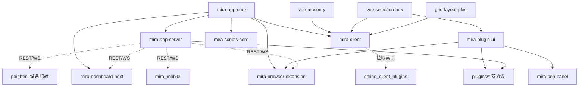

# Mira TypeScript — 新时代的素材管理软件

Mira TypeScript 是基于 TypeScript 的 pnpm workspace monorepo,目标是构建新时代的素材管理软件。核心能力:媒体文件组织/检索/预览/管理(图片/视频/音频/3D/动画/矢量/电子书/归档)、多素材库(独立 SQLite)、**双协议插件架构**(`ServerPlugin` 基类 + `registerFileFormat` 格式注册)、实时 WebSocket(含设备间二进制端到端转发)、Web 管理面板、n8n 集成、跨平台 Electron 桌面客户端、Chrome 浏览器扩展采集入口、Next.js 落地页。

分层:核心库(`mira-app-core`)→ 服务端(`mira-app-server`)→ 客户端(`mira-client` mira-web,Electron + Vue 3)→ 管理面板(`mira-dashboard-next`),外加 Chrome 扩展、Flutter 移动端(`mira_mobile`)、Photoshop CEP 面板(`mira-cep-panel`)、插件共享 UI 组件库(`mira-plugin-ui`)、瀑布流/框选/栅格组件、脚本工具、VitePress 文档、落地页、服务端插件集合(20 个)与客户端插件市场(`online_client_plugins`,6 个)。

> 当前分支:`main`。**core/server/client 已同步升至 v3.0.2**(v3.0.0 引入文件导入三模式/设备间分享/Eagle·Billfish 跨库导入;v3.0.2 = 素材库路径迁移 + 回收站只读保护 + 名称/ID 关联解析 + 语义搜索插件)。详见 [packages/mira-client/CLAUDE.md](packages/mira-client/CLAUDE.md)。

## 约定的规则

- TypeScript strict;服务端 CommonJS,客户端 ESM;移动端为 Flutter(Dart ^3.10)
- API 统一响应 `{ code, data, message?, timestamp }`,路由前缀 `/api/`,共 19 个路由模块;SDK(mira-app-core)覆盖 17 个 API 模块,固定 JSON API 141 条 covered 128(`.audit/sdk-coverage-report.md`,2026-09-09);SDK HttpClient 401 自动重认证
- **文件导入三模式**:`copy`(完整副本,`files.path=NULL`)/`move`(复制后源文件进系统回收站)/`link`(符号链接,Windows EPERM 回退硬链接;`path` 存源路径);库级 `customFields.importType` 配置,见 `docs/library-import-modes.md`
- **插件双协议**:深度插件(`extends ServerPlugin` 或等价自定义类,`registerRounter` 注册路由,含 web/ SPA 的新深度插件)与格式插件 `registerFileFormat(ServerFileFormatHandler)`(声明扩展名/缩略图/查看器);均导出 `init(inst)` 工厂,注册表:`plugins/plugins/plugins.recommend.json`(推荐 11)+ `plugins/plugins/plugins.json`(展示 meta 7)+ 服务端运行时 `src/plugins/plugins.json`(15)
- **客户端 UI 约定**:只用 `@/components/ui`(shadcn-vue),禁用原生控件、禁用直接 import reka-ui、禁用 `--mira-*` 变量;插件侧共享 UI 用 `mira-plugin-ui`
- Electron:Context Isolation 启用,Node Integration 禁用,IPC 经 `contextBridge` 暴露
- 浏览器扩展:跨上下文传文件必须用 `fileToStaged`;MV3 禁 eval
- 服务端 CLI 为多命令结构(`src/cli/commands/`,含 doctor),并内置 MCP 服务(`--mcp` stdio)
- 插件运行时数据(`plugins/plugins/*/data/`)一律 git 忽略,勿提交
- 更多约定见 [claude/conventions.md](claude/conventions.md)

## 文件索引

| 文件 | 用途 | 何时阅读 |
|------|------|----------|
| [claude/overview.md](claude/overview.md) | 架构总览、分层、技术栈 | 首次了解项目 |
| [claude/conventions.md](claude/conventions.md) | 编码/API/插件双协议/安全约定 | 改代码前 |
| [claude/module-index.md](claude/module-index.md) | 全部模块职责 + 20 插件表 + 在线插件表 + 已移除模块 | 定位模块 |
| [claude/entrypoints.md](claude/entrypoints.md) | 入口与启动编排 | 运行/构建 |
| [claude/public-interfaces.md](claude/public-interfaces.md) | REST/WS/SDK/IPC/CLI 聚合 | 对接接口 |
| [claude/dependencies-and-config.md](claude/dependencies-and-config.md) | 依赖版本、配置、环境变量 | 排查依赖 |
| [claude/data-model.md](claude/data-model.md) | SQLite 实体、消息结构、客户端状态 | 数据层改动 |
| [claude/testing-and-quality.md](claude/testing-and-quality.md) | 测试/lint/质量风险 | 质量评估 |
| [claude/file-map.md](claude/file-map.md) | 目录树与关键文件 | 找文件 |
| [claude/faq.md](claude/faq.md) | 常见问题定位 | 遇到坑 |
| [claude/report.md](claude/report.md) | 代码自检报告(结构/重复/可读性/复用) | 写新功能前 / 排查质量问题时 |
| [docs/feature_map.html](docs/feature_map.html) | 功能依赖图谱(功能→文件双向检索,离线可开) | 定位功能涉及文件 / 看模块关系 |
| [claude/changelog.md](claude/changelog.md) | 文档索引变更记录 | 看更新历史 |

## 模块索引

| 模块 | 版本 | 职责 | 文档 |
|------|------|------|------|
| mira-app-core | 3.0.2 | 核心库:事件、SQLite 存储(导入三模式)、TS SDK(17 模块,401 重认证)、共享类型 | [packages/mira-app-core/CLAUDE.md](packages/mira-app-core/CLAUDE.md) |
| mira-app-server | 3.0.2 | 服务端:Express + WebSocket(二进制转发),19 路由,CLI + MCP,双协议插件管理器,Eagle/Billfish 导入,素材库路径迁移(LibraryRelocationService) | [packages/mira-app-server/CLAUDE.md](packages/mira-app-server/CLAUDE.md) |
| mira-client | 3.0.2 | Electron 桌面客户端(包名 mira-web):媒体管理、插件(含语义搜索过滤)、Tab、i18n、设备分享、多库多开窗口、miraEventBus 类型化事件总线 | [packages/mira-client/CLAUDE.md](packages/mira-client/CLAUDE.md) |
| mira-dashboard-next | 0.0.0 | Web 管理面板:Vue 3 + shadcn-vue + Tailwind 4,API 已迁移到 SDK,含 /server 运维页(super) | [packages/mira-dashboard-next/CLAUDE.md](packages/mira-dashboard-next/CLAUDE.md) |
| mira-browser-extension | 0.0.1 | Chrome MV3 扩展:网页素材采集(截图/拖拽浮层/嗅探/批量上传),拖拽快传站点黑白名单,Shadow DOM Vue 浮层 | [packages/mira-browser-extension/CLAUDE.md](packages/mira-browser-extension/CLAUDE.md) |
| mira_mobile | 1.0.0+1 | Flutter 移动端:浏览/下载/相册自动备份 | [packages/mira_mobile/CLAUDE.md](packages/mira_mobile/CLAUDE.md) |
| mira-plugin-ui | 1.1.0 | 插件共享 UI 组件库(自包含 dist,CDN 可用;ui 68 目录 + library 媒体库组件族;10 处消费) | [packages/mira-plugin-ui/CLAUDE.md](packages/mira-plugin-ui/CLAUDE.md) |
| grid-layout-plus | 2.0.0-beta.0 | vendored 栅格布局 fork,供 client Home 仪表盘 | [packages/grid-layout-plus/CLAUDE.md](packages/grid-layout-plus/CLAUDE.md) |
| mira-cep-panel | 0.1.0 | Adobe CEP 面板:PS 内浏览/置入 Mira 素材(Chromium 61) | [packages/mira-cep-panel/CLAUDE.md](packages/mira-cep-panel/CLAUDE.md) |
| vue-masonry | 0.1.0 | @hunmer/vue-masonry:Vue 3 瀑布流组件 | [packages/vue-masonry/CLAUDE.md](packages/vue-masonry/CLAUDE.md) |
| vue-selection-box | 0.1.0 | @hunmer/vue-selection-box:Vue 3 框选组件(被 client/plugin-ui 依赖) | [packages/vue-selection-box/CLAUDE.md](packages/vue-selection-box/CLAUDE.md) |
| landing-page | 0.1.0 | efferd-ui:Next.js 16 + React 19 官方落地页(efferd.com,静态导出) | [packages/landing-page/CLAUDE.md](packages/landing-page/CLAUDE.md) |
| mira-scripts-core | 1.0.5 | 脚本工具:数据转换、文件导入 | [packages/mira-scripts-core/CLAUDE.md](packages/mira-scripts-core/CLAUDE.md) |
| mira-doc | 1.0.0 | VitePress 文档站(部署 base /docs/) | [packages/mira-doc/CLAUDE.md](packages/mira-doc/CLAUDE.md) |
| plugins | -- | 服务端插件集合(20 个:6 深度 + 14 格式,全部有独立 CLAUDE.md) | [plugins/CLAUDE.md](plugins/CLAUDE.md) |
| online_client_plugins | -- | 客户端插件市场源仓库(6 个入索引:视频剪辑器/以图搜图/白板/字体操作/2 Demo) | [online_client_plugins/CLAUDE.md](online_client_plugins/CLAUDE.md) |

## 扫描状态

- **更新时间**: 2026-11-21 23:40 CST
- **分支**: main(HEAD b4f39095)
- **已扫描**: 基线 2026-08-25(bc638a73)以来全部 75 个提交、403 个变更文件(+67k/−5.7k),七路并行深扫(client / extension / plugins / plugin-ui / server+core / dashboard+landing+market+scripts / 全仓代码自检);提交信息全为 "fix",结论均取自 diff 与读码取证
- **本次更新要点**(增量,基线 2026-08-25):
  - **版本 3.0.1 → 3.0.2**(core/server/client 同步,e1dfb2d8)
  - **素材库路径迁移落地**:server 新 `LibraryRelocationService`(221 行,停库→流式复制→改写 librarys.json→删源→重启,进度/防并发/回滚)+ `POST/GET /api/libraries/:id/relocate*` 两端点;dashboard 编辑库路径改走迁移 + 进度轮询;`PUT /api/libraries/:id` 行为未变仍只重连
  - **新端点 5 条**:`files/import-path`(仅 loopback)、`files/checkDuplicates`、`tags/file/set-batch` + relocate 两条;**回收站只读保护**:recycled 文件的 rename/update/tag/folder 操作统一 409;**名称/ID 关联**:`FileAssociationResolver`(标签/文件夹按名解析,无则创建)接入 File/Tag/Folder/Download 四路由与 MCP
  - **mira-client**:ui 58→60 目录(+images-badge/pagination/scrollbar,−chapter-scrubber)、IPC 仍 19、stores 仍 15;上传重构(FileUploadDialog 限额/查重/同名跳过 + 新 UploadQueueDialog 队列重试 + 本地路径免重传)、miraEventBus 类型化事件总线(EventBus.ts,14 事件,18 文件迁移)、语义搜索过滤(FilterBar×filterSearchProviders)、字体动作插件链路(FontActionService + font-action 通道)、通知同屏数 1-10、MiraSDKService 401 自动重登
  - **插件生态**:plugins 16→20(+semantic_search 深度:Ollama embedding+gemma3 视觉打标以图搜图,sqlite-vec KNN,8 条路由,默认停用;/+office_viewer:docx/xlsx/pptx/pdf 四格式 @vue-office;/+html_format 纯 viewer;/+font_format:fontkit+sharp 字形缩略图);ai_sdk 路由 11→13;registry 展示 3→7、运行时 11→15
  - **online_client_plugins 5→6**:新增 mira-font-actions(字体激活 + 应用到 Adobe,860x640 自包含窗口,minAppVersion 3.0.2)
  - **mira-plugin-ui**:ui 67→68(+draggable);包级 i18n 单例(src/i18n.ts 631 行 zh/en);树 sort 五模式 + tiles 平铺视图 + 拖放上传;FilterBar 7→8(+date 区间);drag-data 改 DOMParser(+Pinterest 专属);消费方实测 10(9 源码 + pair.html CDN)
  - **浏览器扩展**:src 101→111 文件;拖拽浮层重写为 Shadow DOM Vue 组件(复用 plugin-ui LibraryTreeView);拖拽快传站点黑白名单;「最后使用」排序(node-last-used);库缓存占位;SaveLocationDialog 集成;测试 19→26 文件
  - **SDK**:HttpClient 401 自动重认证(单飞重放);+importFilePath/checkDuplicates/relocate/setFileTagsBatch;retryFileOperation(EBUSY/EPERM 退避);覆盖率 141/128(2026-09-09,`.audit/`)
  - **landing-page**:trailingSlash 静态导出 404 修复
  - **功能依赖图谱首次生成**:`docs/feature_map.json` + `feature_map.html`(vis-network 离线交互,65+ 功能节点、3505 文件条目、vendored 3、unmapped 27,check 通过)
  - **代码自检报告**:`claude/report.md` 首次生成(四组结论:FileRoutes.ts:52 setupRoutes 1605 行为最大上帝函数;formatSize/formatBytes 34 处重复定义;PluginRoutes yauzl 回调嵌套 ≈13 层;22 项可复用资产入表)
- **跳过/陈旧**: 各包 `node_modules/`、`dist/`、`build/`;plugin-ui 68 目录实现体;server/core 两包 public-interfaces.md 逐端点清单未展开;`findings.md`/`progress.md`/`task_plan.md`/`handoff/`/`mira-*-architecture.*` 为会话工件未入图谱(unmapped 登记)
- **下一步建议**: server `FileRoutes.ts`(1780 行)按 report.md 拆分方向重构;`.audit/` 工具链(decide.ts/gen-manifests.ts)无文档;client `any` 765 处收敛;`package-lock.json`(npm 残留)与 `.env` 被 git 跟踪,建议清理
