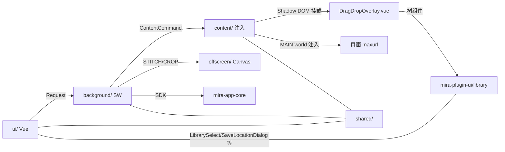

# 模块职责

四个运行时上下文 + 一个共享层。源码按 `src/<context>/` 组织。

## background/ — Service Worker(无 DOM)

| 文件 | 职责 |
|------|------|
| `index.ts` | SW 入口:装配 uploader/capturer/router,监听 onMessage/commands/tabs.onRemoved/onSettingsChange/onInstalled,维护 `sniffSnapshots` Map;DISPATCH_DRAGDROP 下发 `{enabled, mode, hosts}`(host 由 content 过滤) |
| `message-router.ts` | Request 分发中心:认证/配置/多服务器/库/文件夹/标签/节点 CRUD/上传/截图/嗅探/滚动/批量导入/下载的 case 路由;广播 Event;UPLOAD_FROM_URL/BATCH_IMPORT 时 `touchNodeLastUsed` 记录落点使用 |
| `mira-client.ts` | SDK 封装:`ensureClient`/`login`/`autoRelogin`/`withAuth`(401 自动重登一次);token 同步缓存(`cachedToken`) |
| `uploader.ts` | 上传队列:`createUploader`,并发控制、重试、进度通知、成功 TTL 移除、取消;入队时 `touchNodeLastUsed` |
| `capturer.ts` | 截图编排:可视/整页/选区;调 offscreen 拼接裁剪;产 File 入 uploader 队列 |
| `offscreen.ts` | offscreen document 生命周期:`ensureOffscreen`(reason=BLOBS)/`stitchFrames`/`cropImage` |
| `settings.ts` | 设置读写:`getSettings`/`updateSettings`/`onSettingsChange`/`initSettingsWatcher`(绑 storage.onChanged 广播) |
| `inject.ts` | content script 注入兜底:`sendToContent`(失败时 scripting.executeScript 重新注入,文件名从 manifest 动态读) |
| `context-menus.ts` | 右键菜单:截图三件套 + 图片「收藏到素材库」+「从选中批量导入」+「切换当前网站是否开启图片拖拽快速上传」(toggleDragUploadHost 改 dragPopoverHosts)+ 扩展图标右键截图入口;onClicked 监听在模块顶层,菜单项仅 onInstalled 重建(+ .test) |
| `resource-fetch.ts` | 资源抓取:带 cookies/referrer/UA 请求,declarativeNetRequest 临时规则改写头,配 imu `fallbackImageCandidates` |

## content/ — 注入网页(有 DOM)

| 文件 | 职责 |
|------|------|
| `index.ts` | content 入口:装配 sniffer/dragdrop/scroller/hover-button;onMessage 处理 ContentCommand + 截图滚动命令;初始化读设置恢复开关 + 按站点黑白名单过滤 dragdrop;浮层初始库读取/持久化(getOverlayLibraryId/saveOverlayLibraryId);IMU 升级后的 URL 上传 |
| `sniffer.ts` | 资源嗅探:`extractFromDOM`(img/video/audio/background)、`createSniffer`(DOM 扫描 + PerformanceObserver + MutationObserver)、去重/合并 |
| `dragdrop.ts` | 拖拽浮层宿主:拖拽侦测/浮层定位/页面级自动滚动;`createDragDropController` 装配 DragDropOverlay(Shadow DOM 内 createApp 挂载);`collectImagesUnder`(向上找含多图容器供批量导入/复制);浮层树 services 注入(getFolders/getTags 带 libraryId、树 CRUD、排序/样式设置注入)(+ .test) |
| `hover-button.ts` | 图片悬停 dots 按钮:「导入图片」「复制 URL」「在新标签打开大图」,与 dragdrop 同一 controller 模式 |
| `autoscroll.ts` | 自动滚动器:`createAutoScroller`,最大 50 帧,用于整页截图逐帧 |
| `overlay/DragDropOverlay.vue` | 拖拽浮层 UI(Vue 3 + mira-plugin-ui LibraryTreeView):「不设文件夹」根区 +「自定义上传」zone、批量导入/批量复制 URL zone、文件夹|标签双栏树(拖放上传/右键菜单/CRUD)、底部素材库横条 hover 切换(emit library-change)、未连接空态;数据与动作全经 props 注入,不直接访问 chrome API(+ .test) |
| `overlay/dragdrop-overlay.css` | 浮层 Shadow DOM 内的基础样式(host 容器/定位层) |
| `overlay/selection.ts` | 选区截图遮罩:`drawSelection`,全屏遮罩 + 拖拽框选,返回 rect |
| `overlay/import-dialog.ts` | 网页内批量导入对话框(URL 列表/文件夹单选+新建/标签多选 → 逐条 UPLOAD_FROM_URL) |
| `overlay/styles.ts` | overlay 共享样式常量(`OVERLAY_Z`/`OVERLAY_BASE_CSS`) |

## offscreen/ — Offscreen Document(有 Canvas)

| 文件 | 职责 |
|------|------|
| `index.html` | offscreen 页面(挂 `index.ts`) |
| `index.ts` | 监听 STITCH/CROP 消息,调 image-ops |
| `image-ops.ts` | 纯 Canvas 逻辑:`stitch`(多帧拼接)、`crop`(裁剪)、`computeStitchSize`/`scaleRect`(可测纯函数) |

## ui/ — Vue3 UI(popup + side panel + upload 独立窗口)

| 子域 | 职责 |
|------|------|
| `main.ts` | popup/sidepanel 入口:按 HTML 路径定 containerMode;挂载前应用主题(防闪烁) |
| `upload-main.ts` / `upload.html` / `UploadApp.vue` | 批量上传独立窗口页(chrome.windows.create 打开;取 IndexedDB 暂存文件 → `BatchUploadHost`) |
| `App.vue` | 根:自动登录(booting loading)、主题响应、tab 切换、认证过期切登录、i18n locale 同步 |
| `theme.ts` | 主题:resolveTheme(auto→系统偏好)、applyTheme、watchSystemTheme |
| `style.css` | CSS 变量(亮/暗两套 `:root[data-theme]`;不覆盖 shadcn `--muted`,弱化文字用 `--muted-foreground`) |
| `i18n/` | vue-i18n(zh-CN/en);初始 zh-CN,settings 加载后 watch locale 切换 |
| `composables/` | useBackground(消息桥)、useConnection(认证/自动登录/库列表)、useSettings、useSniffer、useUploadQueue、useServers(多服务器)、useLibraryTree(树构建/搜索/排序,含 last_used;re-export mira-plugin-ui/library 的 sortTree 等;+Actions/Hover/搜索测试)、useBatchUpload(批量上传会话)、useDialog、useImagePreview、useImageViewer |
| `components/` | ConnectionForm、GlobalHeader(库选择+主题切换)、TabBar、screenshot/Sniffer(列表+Masonry 瀑布流,「导入到」SaveLocationDialog)/Settings(视图+Overlay)/upload(视图+BatchUploadHost 等)/dragdrop/CustomUploadView(顶部素材库横条+缓存占位)、library/{LibraryPicker(mira-plugin-ui LibrarySelect), LibraryTreeView}、ui 原语(Button/Input/Switch/Progress/DialogHost/ImageHovercard/ImageViewer) |

## shared/ — 跨上下文共享

| 文件 | 职责 |
|------|------|
| `types.ts` | `ExtensionSettings`/`DEFAULT_SETTINGS`(含 servers/activeServerId/locale/sniffer 过滤/batchImportConcurrency/imuRules/dragPopoverMode+Hosts/树样式与排序/snifferImport* 落点记忆)、`UploadTask`/`StagedFile`/`SniffedResource`/`Theme`/`LibraryTreeStyle`/`LibraryTreeSortMode`/`DragPopoverMode`;导出 `isDragPopoverHostAllowed`(host 黑白名单判定) |
| `messages.ts` | 消息协议:Request(UI/content→SW)、Event(SW→广播)、ContentCommand(SW→content)+ 类型守卫 |
| `storage.ts` | chrome.storage 封装:`loadSettings`/`saveSettings`(合并默认值 + dragPopoverMode 迁移:旧非空 host 列表→whitelist)、session(token/凭据) |
| `staged-file.ts` | 跨上下文文件序列化:`fileToStaged`(number[])/`stagedToFile`(normalizeBytes 全形态)/dataURL 工具 |
| `concurrency.ts` | 并发控制工具 |
| `resource-filename.ts` | 资源文件名生成 |
| `drag-data.ts` | 拖拽数据解析:DOMParser 解析 HTML(还原 `&amp;`、data-* 懒加载属性、srcset 最大候选)、uri-list/x-moz-url/text/url 回退链、Pinterest `x-pinterest-closeup-image` 专用解析(+ .test) |
| `node-last-used.ts` | 落点「最后使用」记录:`touchNodeLastUsed` 导入时 touch 文件夹/标签,200ms 合并写 `mira_node_last_used`(独立 key,不写 settings);`readNodeLastUsed` 供树按 last_used 排序(+ .test) |
| `library-cache.ts` | 库/树数据缓存(内存 + chrome.storage.local 双层):`read/writeCachedLibraries`、`read/writeCachedTree`,key 按服务器+类型+库隔离;面板打开先占位渲染再后台刷新 |
| `imu.ts` | maxurl 封装:MAIN world 注入 + postMessage 桥接,`upgradeImageUrl` 返回排序候选;导出 `fallbackImageCandidates` |
| `debug.ts` | 统一日志 `[mira-ext][tag]` + `mira_debug` 开关(chrome 守卫) |
| `drag-popover.test.ts` | 站点黑白名单判定(isDragPopoverHostAllowed)测试 |

## 子域关系

